<p align="center">
  <a href="https://ragdoll-riot-infinite.vercel.app">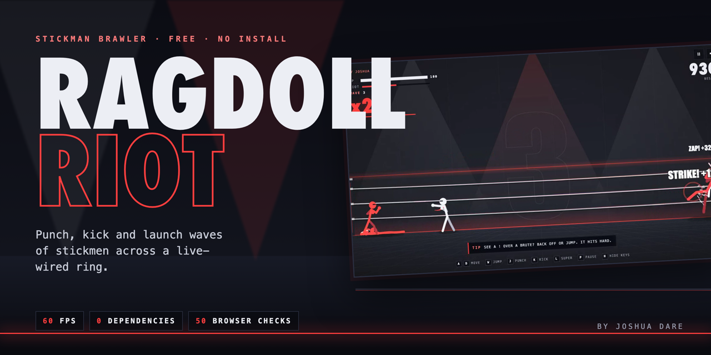</a>
</p>

<p align="center">
  <a href="https://ragdoll-riot-infinite.vercel.app"></a>
  
  
  
</p>

<p align="center">
  <b>Punch, kick and launch waves of stickmen across three living locations, or let the riot spread and break through into a new one every 3 waves.</b><br>
  Plain HTML, CSS and JavaScript. No engine, no framework, no build step. Runs on a phone.
</p>

<p align="center">
  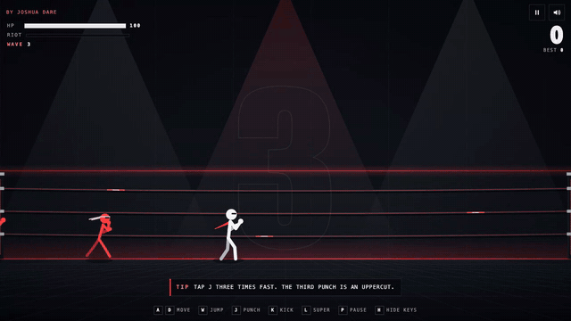
</p>

## Play

**[ragdoll-riot-infinite.vercel.app](https://ragdoll-riot-infinite.vercel.app)** on desktop or phone. Nothing to install.

## Locations and modes

Pick a location on the title screen (click or tap a card, or press the left and right arrow keys; the fight behind the title previews it). Your choice is remembered, `?stage=ring|pit|margins|infinite` deep-links to one, and COPY LINK shares the one you picked. Best score is kept per mode.

| Mode | What it is |
|---|---|
| **THE RIOT SPREADS** (default) | Endless. Every 3 waves the fight breaks through into a new location: the last body's flight triggers slow-mo, the new place wipes in from the side it flew, with debris and a heavy thud. HP, score, multiplier and RIOT meter carry over (the combo timer waits for your first hit in the new place). All 7 pictures are visited before any repeats, never the same place twice running. |
| **THE LIVE RING / THE PIT / THE MARGINS** | Endless waves in one location. The picture changes after each boss. |

| Location | Pictures | Walls (launch enemies into them) | Timed hazard (wave 2+, warns first, hurts everyone) | Finisher | Boss |
|---|---|---|---|---|---|
| **THE LIVE RING** | 3 | electric ropes: **ZAP** | an overhead spotlight locks on a floor patch, then electrifies it | LIGHTS OUT | THE BOUNCER |
| **THE PIT** | 2 | iron spike racks, flames burst on impact: **SPIKED** | a glowing crack in the floor blows a flame jet | SENTENCED | THE WARDEN |
| **THE MARGINS** | 2 | giant pink erasers, crumbs and smudge: **ERASED** | a giant hand scribbles out a patch of the line | SCRATCHED OUT | THE SCRIBBLE |

The last enemy of a wave sent into a wall earns an extended slow-mo, the location's finisher word and a +500 bonus. Each location also has cheap ambient life behind the fighters (phone flashes and a bobbing crowd, flickering flames and swaying hooded figures, doodled stick spectators), and The Margins redraws everything white as ink on paper (the player is dark ink, enemies are red pen, and enemies are drawn on with a pencil scribble). With reduced motion on, transitions are plain crossfades and the ambient motion is frozen (implemented, not covered by a test).

## What's in the ring

| | |
|---|---|
| **Three-hit combo** | Punch three times fast. The third punch is an uppercut that launches. |
| **Kick** | Sends them flying. A flying body knocks down anyone it hits: that's a **STRIKE**. |
| **Juggle** | Hit enemies while they're airborne for bonus points. |
| **Live walls** | Launch enemies into the walls (ropes, spikes or erasers, depending on the location) for a bonus. Get knocked in yourself and it hurts too. |
| **RIOT super** | Every hit fills the RIOT meter. Full meter: press `L` and blast the whole ring off its feet. |
| **Multiplier** | Every 4 hits in a row raise it, up to ×10. Getting hit resets it. |

### Enemies

| | Arrives | How to beat it |
|---|---|---|
| **Grunt** | Wave 1 | A `!` over its head means a swing is coming. |
| **Runner** | Wave 2 | Fast and fragile. It jabs, then backs off. |
| **Brute** | Wave 3 | Huge and slow. When you see the `!`, back off or jump. |
| **Shield** | Wave 4 | Blocks punches from the front. Kick to break the guard, or hit it from behind. |
| **The boss** | Every 5th wave | The Bouncer, The Warden or The Scribble, by location. Too heavy to launch, and it pounds the floor. Jump the shockwaves. |

### Controls

| Action | Keyboard / mouse | Touch |
|---|---|---|
| Move | `A` `D` / arrows | Left stick |
| Jump | `W` / `Space` | Flick the stick up |
| Punch | `J` / left click | Big button |
| Kick | `K` / right click | Small button |
| Super | `L` (when the meter is full) | SUPER button |
| Pause | `P` / `Esc` | ‖ top right |
| How to play | `H` | HOW TO PLAY button |

## Screenshots

These were taken in the original ring, before the locations were added.

<table>
  <tr>
    <td width="50%">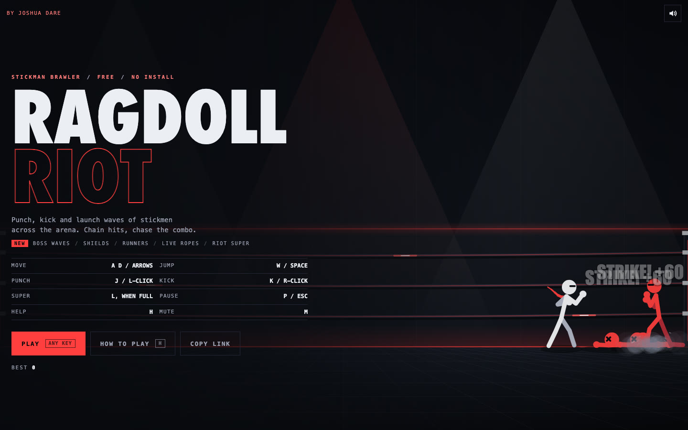<br><sub>Title screen, with a bot fighting in the attract loop</sub></td>
    <td width="50%">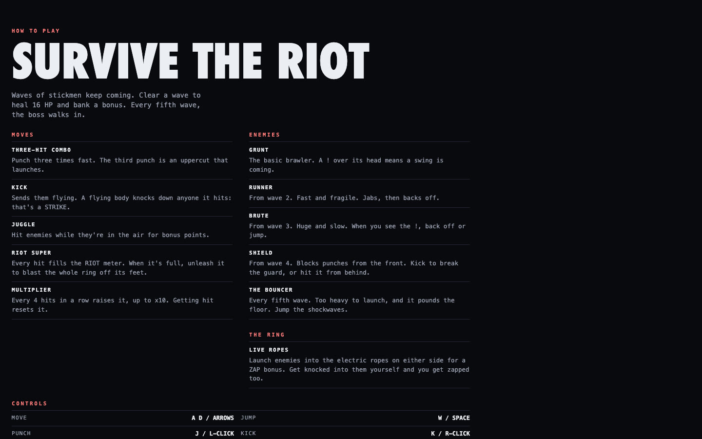<br><sub>How to Play: moves, enemies and the ring</sub></td>
  </tr>
  <tr>
    <td>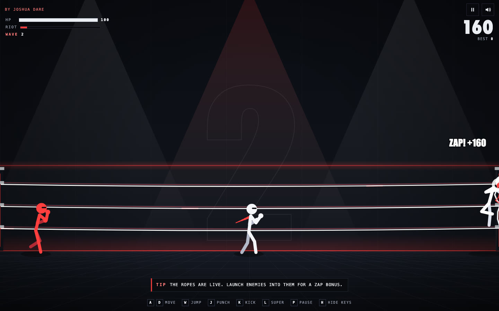<br><sub>Live ropes: the whole ring flares on a ZAP</sub></td>
    <td>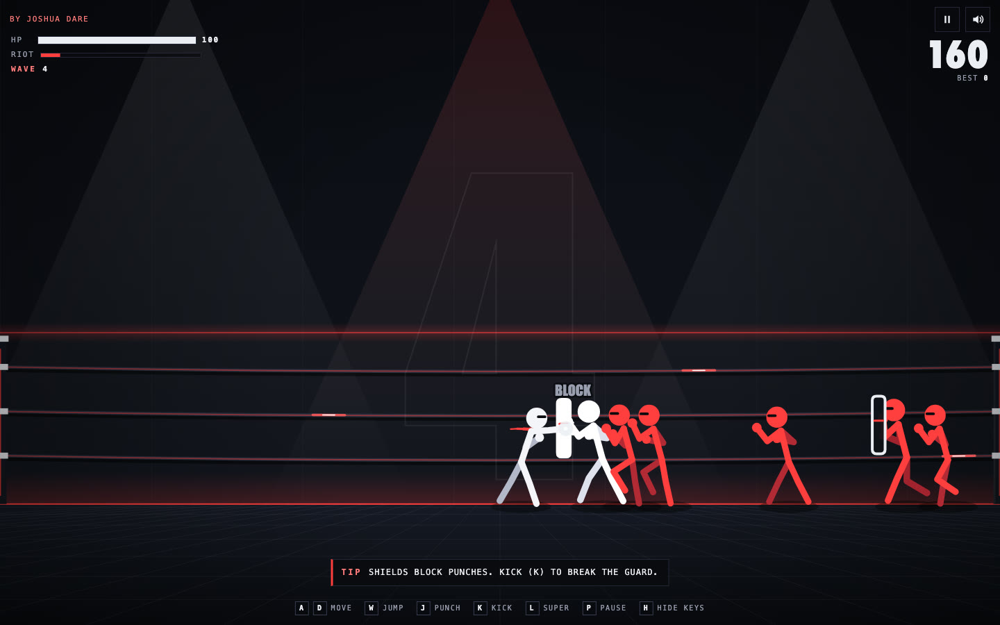<br><sub>Shield guys block punches from the front</sub></td>
  </tr>
  <tr>
    <td>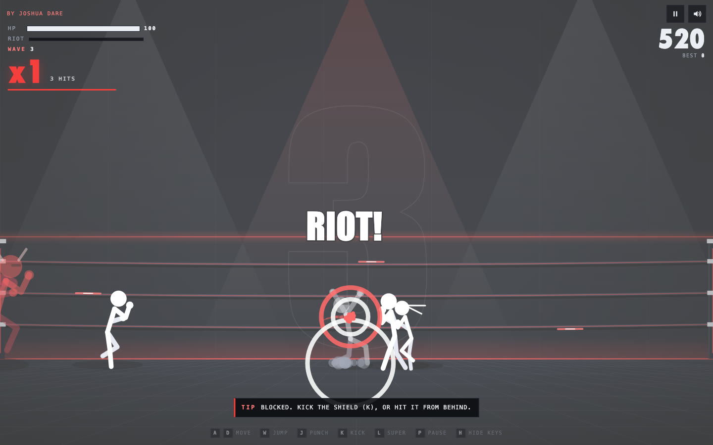<br><sub>The RIOT super</sub></td>
    <td>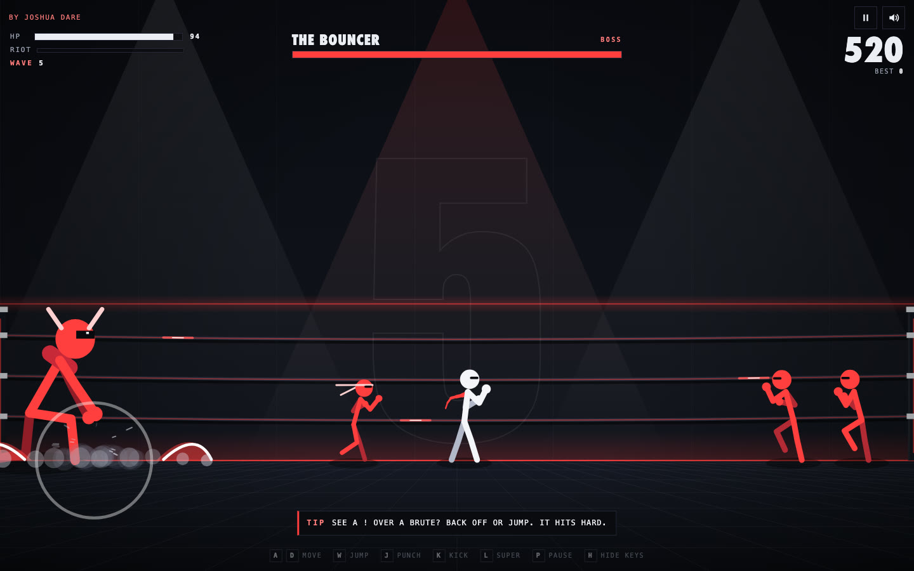<br><sub>The Bouncer, every 5th wave: jump the shockwaves</sub></td>
  </tr>
</table>

<p align="center">
  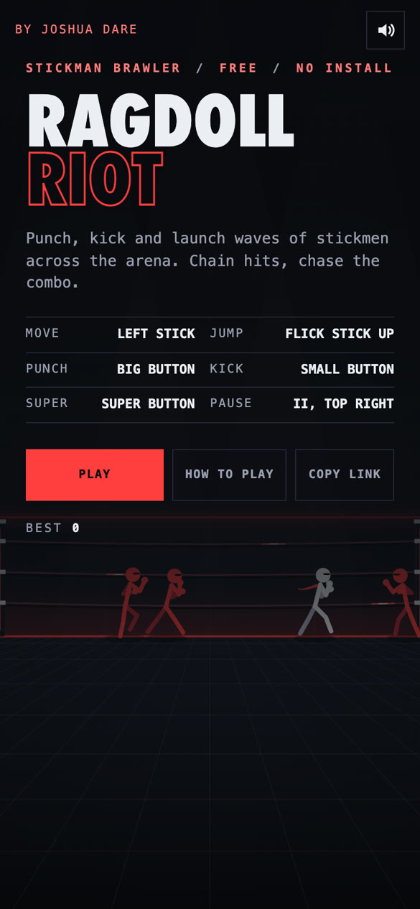
  &nbsp;&nbsp;
  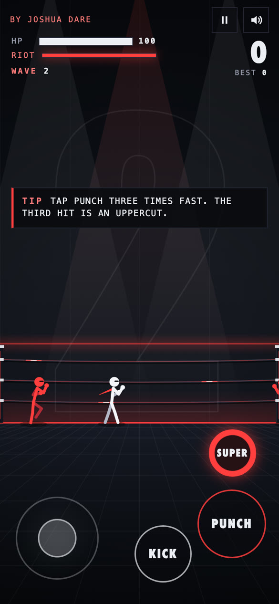
</p>

## How it works

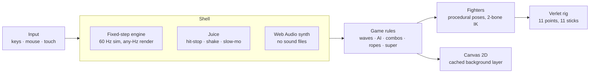

- **One rig, two modes.** Upright fighters are posed procedurally with two-bone IK. A hit hands the same eleven points to a Verlet integrator, so launching a fighter is just "stop posing it": the body keeps the velocity its limbs already had, then flops with real weight.
- **Fixed 60 Hz simulation, interpolated rendering.** Physics stays stable at any refresh rate, and hit-stop and slow-mo work by scaling sim time, not by skipping frames.
- **Two canvases.** The arena backdrop is painted once per resize on its own layer; the main canvas only draws fighters, particles and the ambient life. The only time the backdrop is re-blitted every frame is during a location transition (under 0.9 s), which composites two pictures that were each painted once.
- **Art fits by its floor line.** Each picture is scaled to cover the viewport and positioned so its measured floor line lands exactly where the fighters' feet are, at any aspect ratio. A build step crops the black bands off the pit art and straightens the hand-drawn pencil line in the margins art. If an image fails or is slow, the original procedural background stays up and the game is fully playable.
- **Only two pictures are ever decoded**: the one on screen and the next one, preloaded and decoded ahead of time. If the next one is not ready when a break-through is due, the fight carries on here until it is.
- **No allocation in the loop.** Particles come from a fixed pool, and the HUD only touches the DOM when a value changes.
- **Every sound is synthesized** with oscillators and filtered noise, and the audio context only starts on the first key or tap.
- **Input is action-based with latched edges**, so a tap that lands between two simulation steps (or during hit-stop) is never lost and never counted twice.

## Performance

Measured in headless Chrome on an M3 Pro (`npm test` run of the final code). `scripts/verify.mjs`: 480 frames at 1440×900, 2× pixel ratio, 12 ragdolls on screen, original ring.

| Average frame | p95 frame | Frames over 17.5 ms |
|---|---|---|
| **8.33 ms** | **8.50 ms** | **0** |

`scripts/stages.mjs` repeats the 12-ragdoll stress in each location while a stage hazard is firing (420 frames, 2× pixel ratio):

| Location | 1440×900 avg / p95 | 390×844 avg / p95 | Ambient life, worst frame |
|---|---|---|---|
| The Live Ring | 9.00 / 10.30 ms | 8.37 / 9.20 ms | 0.046 ms |
| The Pit | 9.10 / 16.60 ms | 8.39 / 9.00 ms | 0.049 ms |
| The Margins | 9.04 / 16.40 ms | 8.33 / 9.10 ms | 0.032 ms |

A headless desktop browser is not a phone; none of these numbers is a phone measurement. The 390×844 rows are a phone-sized viewport on the same machine.

## Tests

```sh
npm install   # Playwright, for the tests only
npm test
```

- `scripts/verify.mjs` (17 checks): loads on desktop and phone, touch controls only on touch, PLAY starts a run, 60 fps under load, an idle player reaches game over, instant restart, zero console errors.
- `scripts/features.mjs` (33 checks): How to Play and pause flows, the key legend, tips, the RIOT super, shield block and guard break, rope zaps, the boss's shockwaves and the phone controls.
- `scripts/stages.mjs` (173 checks): every location and variant fits at six viewports (desktop, ultrawide, phone portrait and landscape, small phone, tablet) with the floor on the feet line and no gaps, the picker (keyboard, touch, persistence, deep link, bad stored value, fits without scrolling), every wall word, the timed hazards (telegraph, fairness, hits on both sides), the finisher, THE RIOT SPREADS across all 7 locations, every mid-transition edge case (pause, resize, death, restart), slow and failed images, frame budget in each location, and a 66-wave soak. Screenshots go to `.shots/`.

`npm run build:art` regenerates `art/` from `art-src/` (the original 2752×1536 pictures). Only `art/` ships; `art-src/` is excluded from the deploy.

## Run it locally

```sh
git clone https://github.com/Waleee7/ragdoll-riot-infinite && cd ragdoll-riot-infinite
python3 -m http.server 5173   # then open http://localhost:5173
```

The game uses ES modules, so it needs a local server; opening `index.html` straight from disk won't load it. Add `?debug` to the URL for an FPS overlay and the test hooks.

## Project layout

```text
index.html        screens, HUD and touch controls
style.css         layout, HUD and touch styles
js/main.js        boot
js/shell.js       title → play → game over flow, pause, how to play, key legend
js/engine.js      fixed-timestep loop
js/game.js        waves, enemy AI, combat, live walls, stage hazards, RIOT super, bosses, tips, HUD, run order
js/stages.js      locations: data, run order, art fit
js/art.js         backdrop image cache (decode ahead, current + next only)
js/backdrop.js    cached background layer and location transitions
js/paint.js       backdrop painting: fallbacks, spike racks, erasers, ropes
js/scenery.js     palettes, ambient life, timed hazards, wall-hit effects
js/fighter.js     attack specs, procedural poses, drawing
js/rig.js         Verlet ragdoll: 11 point-masses and distance constraints
js/juice.js       easing, shake, hit-stop, slow-mo, flash, zoom punch
js/particles.js   pooled sparks, dust, rings and popup text
js/audio.js       Web Audio sound synth
js/input.js       keyboard, mouse and touch (floating stick) mapped to actions
js/storage.js     localStorage wrapper that survives private mode
art-src/          the original pictures (not deployed)
art/              shipped pictures and thumbs (built by scripts/build-art.mjs)
scripts/          art build + headless browser tests (Playwright)
```

## Credits

Made by **Joshua Dare** with Claude Code · [GitHub](https://github.com/Waleee7)

© 2026 Joshua Dare. All rights reserved. The source is public to read and learn from; it isn't licensed for reuse.
