<p align="center">
  <a href="https://ragdoll-riot.vercel.app">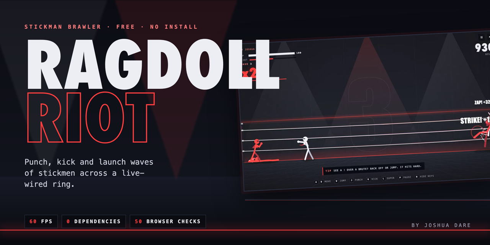</a>
</p>

<p align="center">
  <a href="https://ragdoll-riot.vercel.app"></a>
  
  
  
</p>

<p align="center">
  <b>Punch, kick and launch waves of stickmen across a live-wired ring.</b><br>
  Plain HTML, CSS and JavaScript. No engine, no framework, no build step. Runs on a phone.
</p>

<p align="center">
  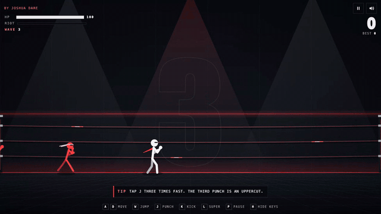
</p>

## Play

**[ragdoll-riot.vercel.app](https://ragdoll-riot.vercel.app)** on desktop or phone. Nothing to install.

## What's in the ring

| | |
|---|---|
| **Three-hit combo** | Punch three times fast. The third punch is an uppercut that launches. |
| **Kick** | Sends them flying. A flying body knocks down anyone it hits: that's a **STRIKE**. |
| **Juggle** | Hit enemies while they're airborne for bonus points. |
| **Live ropes** | Launch enemies into the electric ropes for a **ZAP** bonus. Get knocked in yourself and you get zapped too. |
| **RIOT super** | Every hit fills the RIOT meter. Full meter: press `L` and blast the whole ring off its feet. |
| **Multiplier** | Every 4 hits in a row raise it, up to ×10. Getting hit resets it. |

### Enemies

| | Arrives | How to beat it |
|---|---|---|
| **Grunt** | Wave 1 | A `!` over its head means a swing is coming. |
| **Runner** | Wave 2 | Fast and fragile. It jabs, then backs off. |
| **Brute** | Wave 3 | Huge and slow. When you see the `!`, back off or jump. |
| **Shield** | Wave 4 | Blocks punches from the front. Kick to break the guard, or hit it from behind. |
| **The Bouncer** | Every 5th wave | Too heavy to launch, and it pounds the floor. Jump the shockwaves. |

### Controls

| Action | Keyboard / mouse | Touch |
|---|---|---|
| Move | `A` `D` / arrows | Left stick |
| Jump | `W` / `Space` | Flick the stick up |
| Punch | `J` / left click | Big button |
| Kick | `K` / right click | Small button |
| Super | `L` (when the meter is full) | SUPER button |
| Pause | `P` / `Esc` | ‖ top right |
| How to play | `H` | HOW TO PLAY button |

## Screenshots

<table>
  <tr>
    <td width="50%">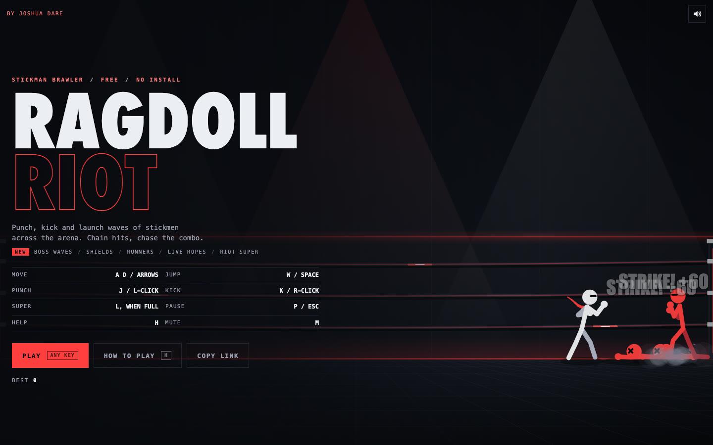<br><sub>Title screen, with a bot fighting in the attract loop</sub></td>
    <td width="50%">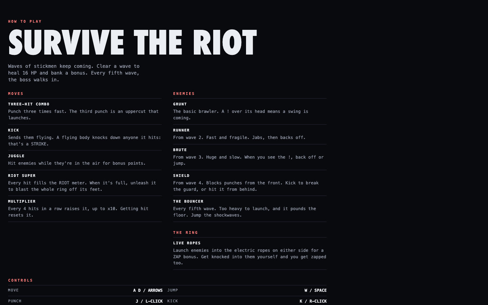<br><sub>How to Play: moves, enemies and the ring</sub></td>
  </tr>
  <tr>
    <td>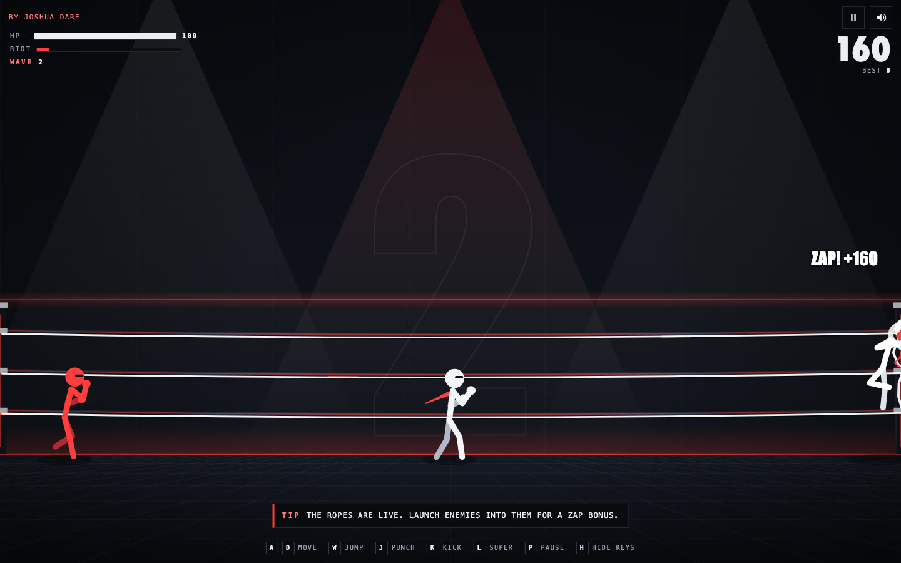<br><sub>Live ropes: the whole ring flares on a ZAP</sub></td>
    <td>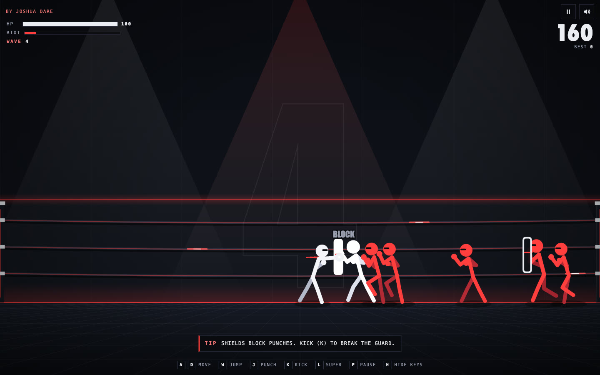<br><sub>Shield guys block punches from the front</sub></td>
  </tr>
  <tr>
    <td>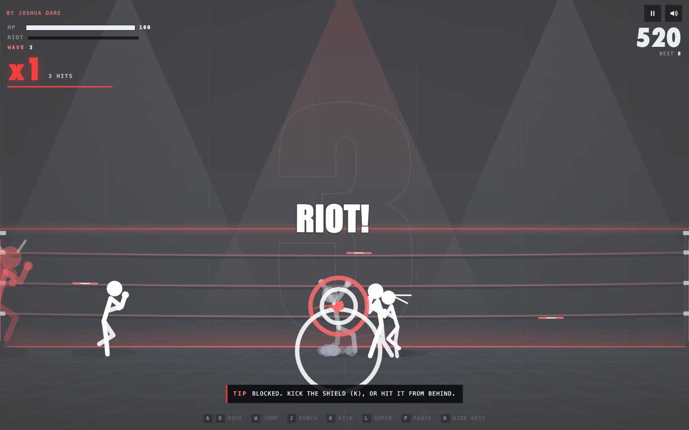<br><sub>The RIOT super</sub></td>
    <td>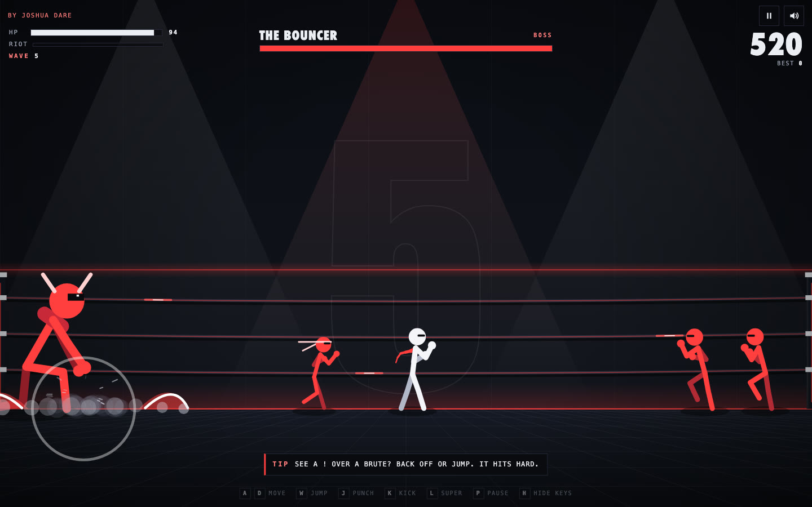<br><sub>The Bouncer, every 5th wave: jump the shockwaves</sub></td>
  </tr>
</table>

<p align="center">
  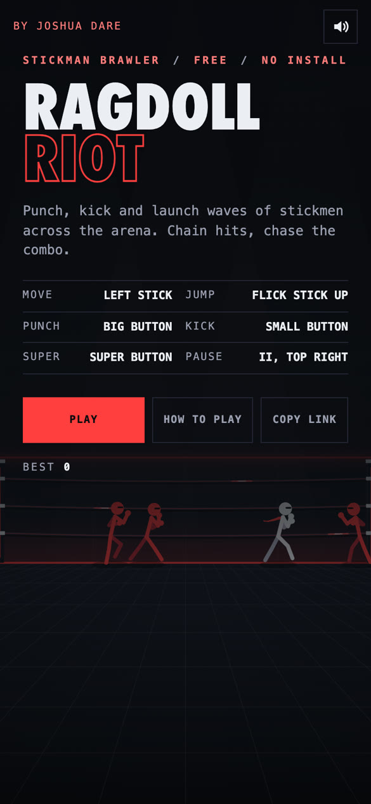
  &nbsp;&nbsp;
  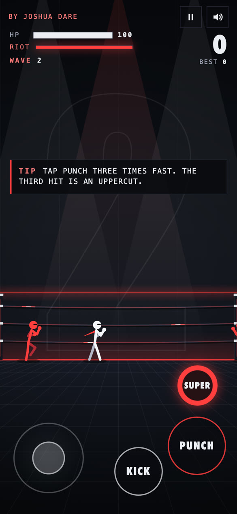
</p>

## How it works

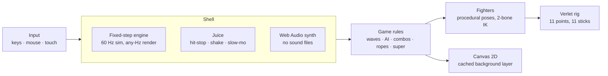

- **One rig, two modes.** Upright fighters are posed procedurally with two-bone IK. A hit hands the same eleven points to a Verlet integrator, so launching a fighter is just "stop posing it": the body keeps the velocity its limbs already had, then flops with real weight.
- **Fixed 60 Hz simulation, interpolated rendering.** Physics stays stable at any refresh rate, and hit-stop and slow-mo work by scaling sim time, not by skipping frames.
- **Two canvases.** The arena backdrop is painted once per resize on its own layer; the main canvas only draws fighters and particles.
- **No allocation in the loop.** Particles come from a fixed pool, and the HUD only touches the DOM when a value changes.
- **Every sound is synthesized** with oscillators and filtered noise, and the audio context only starts on the first key or tap.
- **Input is action-based with latched edges**, so a tap that lands between two simulation steps (or during hit-stop) is never lost and never counted twice.

## Performance

Measured with `scripts/verify.mjs` in headless Chrome on an M3 Pro: 480 frames at 1440×900, 2× pixel ratio, 12 ragdolls on screen.

| Average frame | p95 frame | Frames over 17.5 ms |
|---|---|---|
| **8.33 ms** | **8.40 ms** | **0** |

## Tests

```sh
npm install   # Playwright, for the tests only
npm test
```

- `scripts/verify.mjs` (17 checks): loads on desktop and phone, touch controls only on touch, PLAY starts a run, 60 fps under load, an idle player reaches game over, instant restart, zero console errors.
- `scripts/features.mjs` (33 checks): How to Play and pause flows, the key legend, tips, the RIOT super, shield block and guard break, rope zaps, the boss's shockwaves and the phone controls.

## Run it locally

```sh
git clone https://github.com/Waleee7/ragdoll-riot && cd ragdoll-riot
python3 -m http.server 5173   # then open http://localhost:5173
```

The game uses ES modules, so it needs a local server; opening `index.html` straight from disk won't load it. Add `?debug` to the URL for an FPS overlay.

## Project layout

```text
index.html        screens, HUD and touch controls
style.css         layout, HUD and touch styles
js/main.js        boot
js/shell.js       title → play → game over flow, pause, how to play, key legend
js/engine.js      fixed-timestep loop
js/game.js        waves, enemy AI, combat, live ropes, RIOT super, boss, tips, HUD
js/fighter.js     attack specs, procedural poses, drawing
js/rig.js         Verlet ragdoll: 11 point-masses and distance constraints
js/juice.js       easing, shake, hit-stop, slow-mo, flash, zoom punch
js/particles.js   pooled sparks, dust, rings and popup text
js/audio.js       Web Audio sound synth
js/input.js       keyboard, mouse and touch (floating stick) mapped to actions
js/storage.js     localStorage wrapper that survives private mode
scripts/          headless browser tests (Playwright)
```

## Credits

Made by **Joshua Dare** with Claude Code · [GitHub](https://github.com/Waleee7)

© 2026 Joshua Dare. All rights reserved. The source is public to read and learn from; it isn't licensed for reuse.
